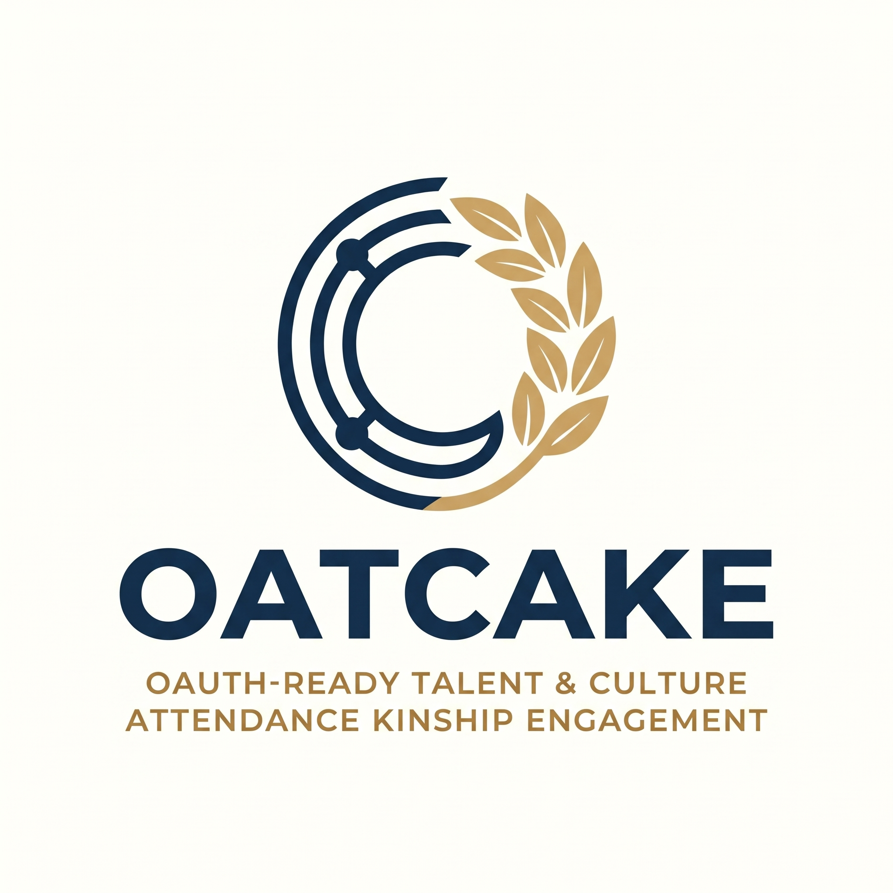

<p align="center">
  
</p>

# OATCAKE

**Hospitality HRIS & 24-Hour Roster Scheduling Platform**

OATCAKE adalah platform manajemen SDM dan penjadwalan rotasi kerja 24 jam non-stop yang dirancang khusus untuk operasional industri perhotelan dan resort berskala enterprise.

---

## Fitur Utama

- **Multi-Tenancy**: Isolasi data antar properti hotel secara menyeluruh dengan dukungan kustomisasi tema dan warna aksen setiap tenant.
- **Dual-Authentication & Closed Provisioning**: Sistem login ganda berbasis Google OAuth dan kredensial manual (username/email). Pendaftaran publik ditutup untuk memastikan seluruh staf didaftarkan secara terpusat oleh manajemen.
- **5-Tier Role-Based Access Control (RBAC)**: Pembagian hak akses terstruktur mulai dari *Super Admin*, *Corporate Executive*, *HR Admin*, *Department Manager*, hingga *Staff*, termasuk dukungan multi-*super user* dan hak akses peninjauan jadwal lintas departemen (*read-only* `VIEW_ALL_SCHEDULES`).
- **Gantt Chart Roster Kalender 24 Jam**: Matriks penjadwalan rotasi kerja *dual-axis sticky* bebas *double-scroll* dengan penugasan *drag-and-drop*, *snapping resize* presisi 15 menit, mesin geser shift utuh (*shift drag-to-slide*), visualisasi shift lintas hari (*overnight*), badge durasi akumulasi jam kerja bersih, dan linimasa 24 jam interaktif per tanggal.
- **Split-Shift Engine**: Kemampuan membelah satu jadwal shift aktif menjadi dua sesi kerja terpisah pada hari yang sama dengan kalkulasi titik tengah otomatis dan preservasi durasi total kerja yang identik ($Durasi_1 + Durasi_2 = Durasi_{\text{awal}}$).
- **Linimasa 24 Jam Hari Ini di Dashboard**: Modal Gantt Chart 24 jam native (`<x-ui.modal>`) pada dashboard utama untuk meninjau jadwal seluruh staf lintas departemen secara langsung dengan isolasi *multi-tenancy* dan penyaringan visibilitas draf berbasis peran.
- **Kompatibilitas Layar Sentuh Mobile & Bebas Overflow**: Mesin *touch-drag* dan *touch-tap* terintegrasi pada palet shift, menu aksi cepat (*popover actions*), serta toolbar responsif bebas *overflow horizontal* pada layar gawai seluler (360px–430px).
- **Turnaround & 24-Hour Formation Intelligence**: Deteksi *soft turnaround warning* jeda istirahat (< 8 jam), pendeteksi celah kekosongan formasi operasional 24 jam (*gap detector*), audit ketersediaan harian *Manager on Duty* (MOD), serta peringatan batas jam kerja mingguan (> 40 jam/minggu).
- **Siklus Draf, Publikasi & Rollback**: Alur perubahan jadwal berbasis draf, penanda visual *pending-delete ghost* untuk penghapusan jadwal terpublikasi, serta tombol pembatalan draf (*discard changes*) yang memulihkan ukuran dan status jadwal sebelumnya.
- **Hospitality Design System**: Antarmuka adaptif dengan dukungan Dark Mode bebas kedip (anti-FOUC), kontras warna yang memenuhi standar aksesibilitas WCAG AA (rasio kontras ≥ 4.5:1), serta tabel data berdensitas tinggi.
- **Presensi Geofencing GPS Real-Time & Early Clock-Out Guard**: Pencatatan presensi masuk dan pulang (*Clock In* / *Clock Out*) berbasis koordinat GPS perangkat dengan validasi jarak radius toleransi (formula Haversine) terhadap properti hotel, dukungan presensi dua sesi (*split-shift session*), serta dialog konfirmasi peringatan (*early clock-out guard*) jika staf melakukan *clock out* sebelum jam kerja shift berakhir ($T_{\text{now}} < T_{\text{end}}$).
- **Universal Mandatory Selfie & Pipeline Kompresi WebP**: Kewajiban pengambilan swafoto biometrik kamera depan perangkat (`capture="user"`) pada setiap transaksi presensi (masuk, pulang, dan dinas luar) dengan optimasi ganda (canvas *pre-compression* sisi klien $\le 1280$px dan kompresi WebP sisi server $\le 250$ KB via Intervention Image v4) lengkap dengan pembersihan metadata EXIF.
- **Proteksi Kuota Storage Tenant & Retensi Otomatis (Auto-Erase)**: Pembatasan kuota penyimpanan berkas per properti (`storage_limit_mb`) yang dikendalikan oleh *Super Admin*, kebijakan retensi swafoto berdurasi fleksibel (1, 3, 6, atau 12 bulan) dengan pembersihan fisik terjadwal harian (`attendance:prune-photos`) untuk mencegah lonjakan kapasitas disk server.
- **Presensi Dinas Luar & Konsol Verifikasi Manajer**: Alur presensi tugas luar jangkauan geofence hotel dengan klasifikasi kategori, destinasi, dan catatan tujuan, serta konsol persetujuan/penolakan berjenjang bagi manajer dengan inspeksi deviasi spasial berbasis peta interaktif (Leaflet.js).
- **Rekonsiliasi Riwayat Presensi Administratif**: Log audit presensi komprehensif (`/attendance`) dengan inspeksi berkas swafoto beresolusi penuh via *secure streaming endpoint*, serta hak penuh bagi *Administrator* untuk merevisi cap waktu/status maupun menghapus rekod presensi beserta pembersihan fisik berkas swafoto dari disk privat.
- **Pelacakan Otomatis DP Libur Nasional (Provisional DP)**: Integrasi kalender hari libur nasional (`public_holidays`) dengan penandaan otomatis status *Provisional DP* bagi staf yang bertugas pada hari libur resmi tanpa mengganggu integritas buku besar cuti (*ledger isolation*).
- **Tata Kelola Master Departemen & Pengaturan Properti**: Manajemen departemen mandiri dengan konfigurasi operasional 24 jam, batas minimum staf per shift, dan proteksi hapus aman (*safe delete*), serta halaman pengaturan properti untuk koordinat geofence, zona waktu Indonesia (WIB/WITA/WIT), dan pemantau kuota penyimpanan dinamis.
- **Manajemen Saldo DP (Day of Payment)**: Pengelolaan hak libur pengganti dan kompensasi shift untuk penugasan pada hari libur nasional atau lembur operasional.
- **Dukungan Multi-Bahasa**: Pilihan bahasa Indonesia dan Inggris dengan peralihan instan dan paritas kamus 100%.

---

## Tech Stack

- **Backend**: Laravel 12 & PHP 8.4+
- **Database**: PostgreSQL 18
- **Frontend**: Tailwind CSS, Alpine.js, InteractJS, Leaflet.js, & @alpinejs/collapse
- **Image Processing**: Intervention Image v4 (kompresi WebP & sanitasi EXIF)
- **Autentikasi**: Laravel Socialite (Google OAuth 2.0) & Session Guard

---

## Instalasi & Menjalankan Aplikasi

### Prasyarat
- PHP >= 8.4
- PostgreSQL >= 18
- Composer
- Node.js & NPM

### Langkah Setup

1. **Clone repositori**:
   ```bash
   git clone git@github.com:nabararifki/oatcake.git
   cd oatcake
   ```

2. **Pasang dependensi**:
   ```bash
   composer install
   npm install
   ```

3. **Konfigurasi environment**:
   ```bash
   cp .env.example .env
   php artisan key:generate
   ```
   Sesuaikan kredensial database PostgreSQL dan Google OAuth di berkas `.env`.

4. **Migrasi dan seeding database**:
   ```bash
   php artisan migrate --seed
   ```

5. **Kompilasi aset frontend**:
   ```bash
   npm run build
   ```

6. **Jalankan server aplikasi**:
   ```bash
   php artisan serve
   ```

---

## Pengujian

Jalankan seluruh rangkaian pengujian otomatis:

```bash
php artisan test
```

Untuk menjalankan pengujian fitur tertentu:
```bash
# Pengujian autentikasi ganda
php artisan test --filter DualAuthenticationTest

# Pengujian hak akses dan RBAC
php artisan test --filter RoleAwareLayoutAndPolicyTest

# Pengujian kepatuhan kontras WCAG AA
php artisan test --filter AccentTest

# Pengujian interaktivitas roster & resizing
php artisan test --filter RosterInteractionTest

# Pengujian logika bisnis roster & formasi 24 jam
php artisan test --filter RosterBusinessLogicTest

# Pengujian direktori dan provisioning staf
php artisan test --filter StaffProvisioningTest

# Pengujian jadwal harian lintas departemen di dashboard
php artisan test --filter DashboardScheduleTest

# Pengujian presensi geofencing & early clock-out guard
php artisan test --filter AttendanceGeofenceTest

# Pengujian swafoto universal, kompresi WebP & retensi storage
php artisan test --filter UniversalSelfieTest

# Pengujian konsol verifikasi presensi dinas luar
php artisan test --filter AttendanceVerificationTest

# Pengujian rekonsiliasi riwayat presensi administratif
php artisan test --filter AttendanceAdminTest

# Pengujian manajemen departemen & proteksi safe-delete
php artisan test --filter DepartmentManagementTest

# Pengujian pengaturan properti & kuota storage tenant
php artisan test --filter CompanySettingsTest

# Pengujian pelacakan otomatis provisional DP hari libur
php artisan test --filter ProvisionalDpTrackerTest

# Pengujian paritas lokalisasi dwi-bahasa
php artisan test --filter LangParityTest
```

---

## Lisensi

Platform OATCAKE dilisensikan di bawah lisensi [GNU General Public License v3.0 (GPL-3.0)](LICENSE).
