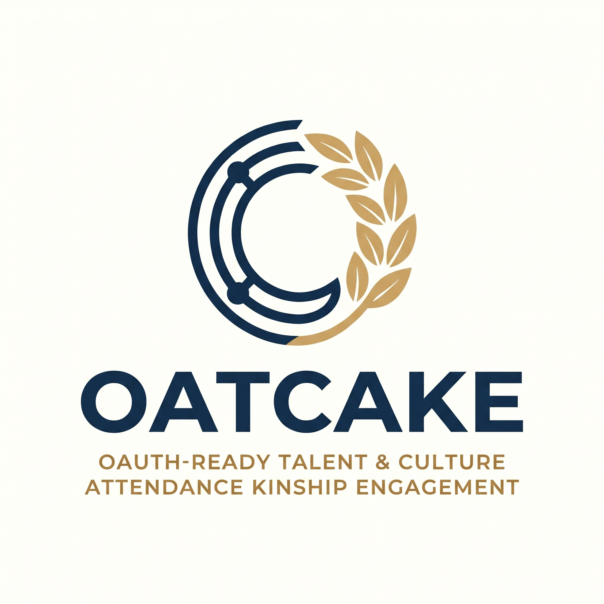

<p align="center">
  
</p>

# OATCAKE

**Hospitality HRIS & 24-Hour Roster Scheduling Platform**

OATCAKE adalah platform manajemen SDM dan penjadwalan rotasi kerja 24 jam non-stop yang dirancang khusus untuk operasional industri perhotelan dan resort berskala enterprise.

---

## Fitur Unggulan

- **Multi-Tenant Enterprise & 5-Tier RBAC (*Strict Zero NIK*)**: Isolasi data penuh antar properti hotel dengan *branding* aksen dinamis berkontras WCAG AA, autentikasi ganda (*Google OAuth 2.0* & kredensial internal) dengan registrasi publik tertutup, serta kontrol akses 5 tingkat (*Super Admin*, *Corporate Executive*, *HR Admin*, *Department Manager*, *Staff*).
- **24-Hour Gantt Roster & Split-Shift Engine**: Matriks penjadwalan rotasi 31 hari *dual-axis sticky* berbasis InteractJS (*drag-and-drop*, *resize* 15 menit, geser balok utuh, lintas tengah malam, dan *split-shift* dalam 1 hari) yang ramah layar sentuh mobile, lengkap dengan deteksi *turnaround* $< 8$ jam, celah formasi 24 jam, pemantauan MOD, serta siklus draf/publikasi/rollback.
- **Presensi Geospasial, Swafoto WebP & Kebijakan Jadwal**: Validasi lokasi real-time berbasis radius Haversine (termasuk presensi dinas luar dengan inspeksi peta Leaflet.js), swafoto wajib kamera depan yang dikompresi otomatis ke WebP ($\le 250\text{ KB}$, sanitasi EXIF) sesuai kuota & retensi tenant, *Early Clock-Out Guard*, pelacakan hari libur (*Two-Phase DP Commit*), serta pengaturan toggle kebijakan presensi tanpa jadwal (`auto_assign_shift_on_clock_in`).
- **Manajemen Cuti, Buku Besar Append-Only (FIFO) & Persetujuan 2-Tier**: Pengajuan cuti terintegrasi kalender roster dengan satuan hari bilangan bulat (*integer days*), buku besar saldo *append-only* berkekuatan *row-level lock* (deplesi FIFO berdasar tanggal kedaluwarsa), persetujuan berjenjang Manajer $\rightarrow$ HR, penguncian otomatis jadwal `LEAVE:` pada roster, serta *append-only refund* saat pengeditan/pembatalan.
- **SPK Metode SMART & Mode Debug Simulator**: Mesin pendukung keputusan berbasis 5 kriteria telemetri kuantitatif (`C1`–`C5`), pembobotan dinamis per departemen, evaluasi mandiri (**Mode B**) dan pemeringkatan kandidat bentrok (**Mode A**), dilengkapi konsol **Mode Debug & What-If Simulator** khusus *Super Admin*.
- **Progressive Web App (PWA) & Web Push Real-Time (VAPID)**: Dapat diinstal sebagai aplikasi mandiri lengkap dengan mekanisme panduan HTTP non-HTTPS, *Service Worker* multi-tier beserta *Offline Snapshot* jadwal 14 hari & saldo cuti, serta pusat notifikasi real-time terenkripsi RFC 8291/8292 melalui PHP OpenSSL P-256 tanpa dependensi pihak ketiga eksternal.
- **Immutable JSONB Audit Trail Console**: Pencatatan otomatis mutasi data inti secara *append-only* (menolak ubah/hapus via `LogicException`) ke PostgreSQL `JSONB` terindeks `GIN`, dilengkapi sanitasi Zero-NIK, penelusuran forensik `@>`, dan tampilan perbandingan perubahan (*side-by-side diff*).
- **Optimasi Co-Hosting, Pengaturan Terkategorisasi & Dwi-Bahasa**: Pemuatan halaman utama $\le 15$ kueri melalui indeks komposit PostgreSQL dan *eager loading*, konsol pengaturan perusahaan (`/settings/company`) dengan pencarian real-time lintas 4 kategori, perintah diagnostik `oatcake:optimize-cohosting` & `oatcake:prepare-uat`, serta antarmuka dwi-bahasa (ID/EN) dengan paritas kamus 100%.

---

## Tech Stack

- **Backend**: Laravel 12 & PHP 8.4+ (OpenSSL Web Push RFC 8291/8292)
- **Database**: PostgreSQL 18 (`JSONB` + Indeks `GIN` & Indeks Komposit)
- **Frontend & PWA**: Tailwind CSS, Alpine.js, InteractJS, Leaflet.js, Service Worker & Web App Manifest
- **Image Processing**: Intervention Image v4 (kompresi WebP & sanitasi EXIF)
- **Autentikasi**: Laravel Socialite (Google OAuth 2.0) & Session Guard

---

## Instalasi & Menjalankan Aplikasi

### Prasyarat
- PHP >= 8.4
- PostgreSQL >= 18
- Composer
- Node.js & NPM

### Langkah Setup

1. **Clone repositori**:
   ```bash
   git clone git@github.com:nabararifki/oatcake.git
   cd oatcake
   ```

2. **Pasang dependensi**:
   ```bash
   composer install
   npm install
   ```

3. **Konfigurasi environment**:
   ```bash
   cp .env.example .env
   php artisan key:generate
   ```
   Sesuaikan kredensial database PostgreSQL dan Google OAuth di berkas `.env`.

4. **Migrasi dan seeding database**:
   ```bash
   php artisan migrate --seed
   ```

5. **Kompilasi aset frontend**:
   ```bash
   npm run build
   ```

6. **Jalankan server aplikasi**:
   ```bash
   php artisan serve
   ```

---

## Pengujian

Jalankan seluruh rangkaian pengujian otomatis (**227 pengujian / 6.249 asersi**):

```bash
php artisan test
```

Contoh eksekusi pengujian berdasarkan domain modul utama:
```bash
# Autentikasi, RBAC & Kepatuhan Tema WCAG AA
php artisan test --filter "DualAuthenticationTest|RoleAwareLayoutAndPolicyTest|AccentTest|LangParityTest"

# Roster 24 Jam & Jadwal Dashboard
php artisan test --filter "RosterInteractionTest|RosterBusinessLogicTest|DashboardScheduleTest|StaffProvisioningTest"

# Presensi Geospasial, Swafoto WebP, Kebijakan Jadwal & Two-Phase DP
php artisan test --filter "AttendanceGeofenceTest|UniversalSelfieTest|AttendanceVerificationTest|AutoAssignNearestShiftTest|TwoPhaseDpCommitTest"

# Manajemen Cuti, Ledger FIFO, Persetujuan 2-Tier & SPK SMART (+ Mode Debug)
php artisan test --filter "LeaveLedgerTest|LeaveRequestTest|LeaveApprovalWorkflowTest|SmartDecisionEngineTest"

# PWA, Web Push VAPID, Immutable JSONB Audit Trail, Stress Test & UAT Mitra
php artisan test --filter "PwaImplementationTest|WebPushNotificationTest|AuditTrailLoggingTest|StressAndResourceOptimizationTest|UatMitraAcceptanceTest"
```

---

## Lisensi

Platform OATCAKE dilisensikan di bawah lisensi [GNU General Public License v3.0 (GPL-3.0)](LICENSE).
